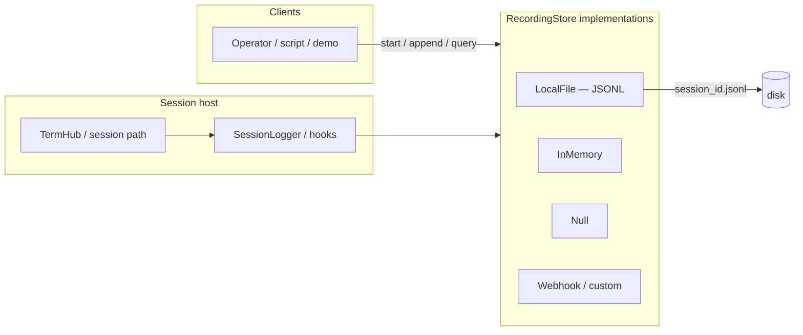
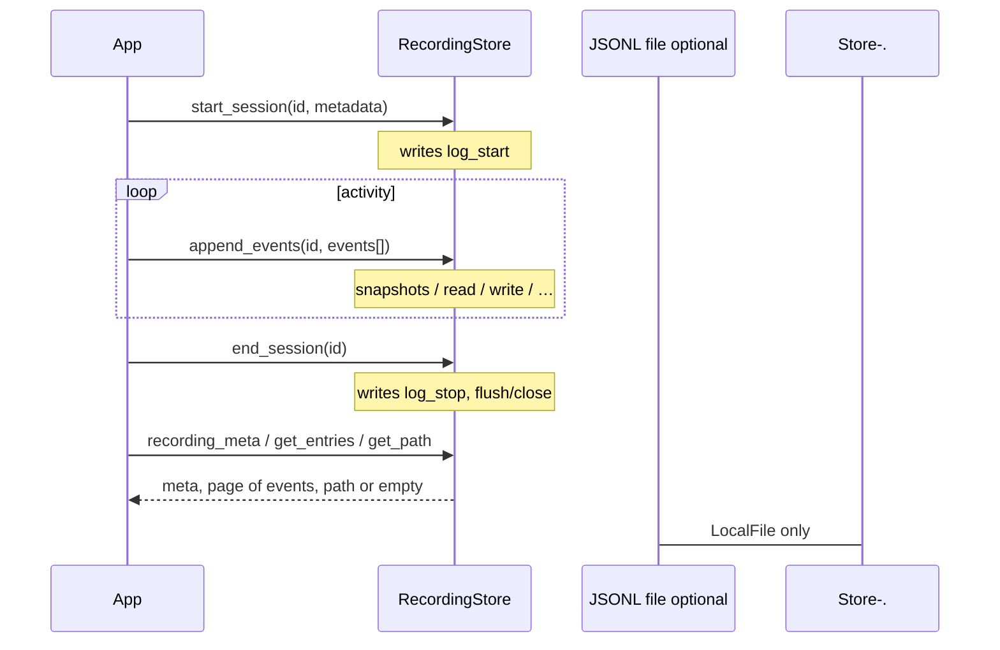
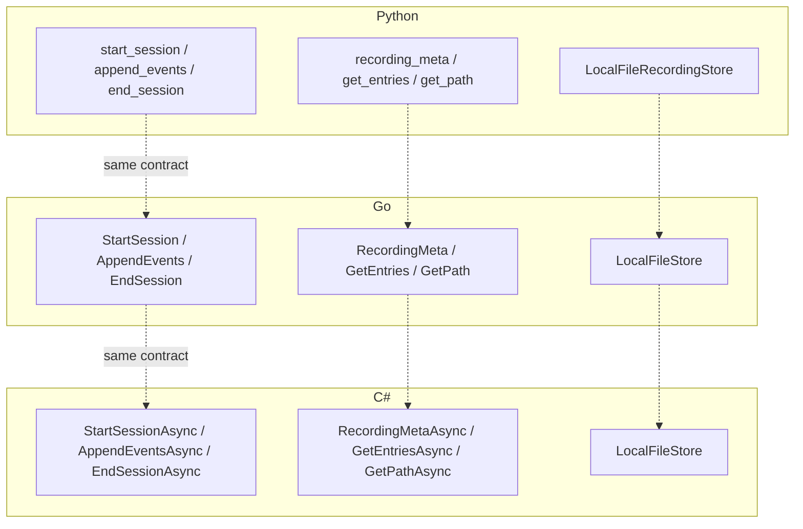
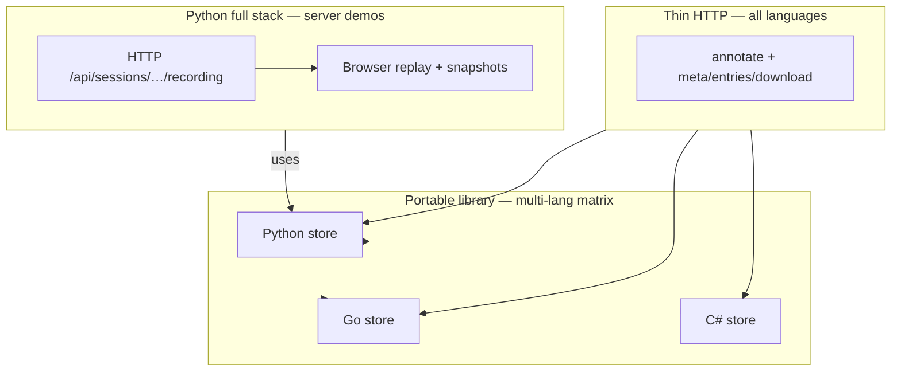

# Recording store — multi-language parity

This document describes the **portable `RecordingStore` contract** shared by
Python, Go, and C#, how the pieces fit together, and how to re-record the
library-level demos.

Operator-facing data handling (PII, retention, defaults) remains in
[recording-data-handling.md](./recording-data-handling.md). The ARD for
compliance recording is [ard-session-audit-compliance-recording.md](../ard-session-audit-compliance-recording.md).

## TL;DR

| Layer | Same? | Notes |
|-------|-------|--------|
| Lifecycle (start → append* → end) | **Yes** | All three ports |
| Event JSON shape | **Yes** | `{ts, event, data, session_id?}` |
| Query semantics (`limit` / `offset` / event filter) | **Yes** | `limit=0` → default **200**, clamp **1..500** |
| Stores LocalFile / InMemory / Null | **Yes** | Same roles |
| Session instances (no cross-session reads) | **Yes** | Python, Go, TypeScript and C# — see [Session instances](#session-instances) |
| Public method names / async style | **No** | Idiomatic per language |
| Full HTTP/server recording surface | **Yes (thin)** | annotate + meta / entries / download on all three |

Python is the **behavioral source of truth**. Go and C# match that behavior with
idiomatic surfaces (sync+error, `Task`/`Async`).

## Architecture

### Where the store sits



### Lifecycle (all languages)



### Cross-language map



## Contract details

### Methods

| Semantic | Python | Go | C# |
|----------|--------|-----|-----|
| Start | `start_session` | `StartSession` | `StartSessionAsync` |
| Append batch | `append_events` | `AppendEvents` | `AppendEventsAsync` |
| End | `end_session` | `EndSession` | `EndSessionAsync` |
| Meta | `recording_meta` → `dict` | `RecordingMeta` → `Meta` | `RecordingMetaAsync` → `Meta` |
| Query | `get_entries(..., limit, offset, event)` | `GetEntries(id, Query)` | `GetEntriesAsync(id, Query)` |
| Path | `get_path` → `Path \| None` | `GetPath` → `""` if none | `GetPathAsync` → `""` if none |

### `get_entries` rules (parity-critical)

| Input | Behavior |
|-------|----------|
| `limit` omitted / default | **200** |
| `limit == 0` | **200** (explicit zero is not “clamp to 1”) |
| `limit` other | clamp to **1..500** |
| `offset is None` / null | **tail**: last `limit` matching events |
| `offset >= 0` | skip that many matches, then take `limit` |
| `offset < 0` | skip **nothing** (treat as 0) |
| `event` set | only rows with `event` field equal to filter |
| Missing session / file | empty list, not an error |

### Event model (JSONL line)

Minimum keys on each line:

```json
{"ts": 1710000000.0, "event": "snapshot", "data": {"screen": "…", "seq": 0}, "session_id": "demo"}
```

Lifecycle events written by the store:

| `event` | When |
|---------|------|
| `log_start` | `start_session` |
| `log_stop` | `end_session` |

### Session instances

A session id does not name one session forever. A PAM capture session was named
after the pid of the login's `sshd-session` process, and pids are reused; any
session can be deleted and its id created again. Recording reads are authorized
against whichever session holds the id **now**, so a store that kept appending
to `{session_id}.jsonl` handed a new session every earlier holder's entries
(terminal I/O, keystrokes included) for the whole retention period.

`start_session` therefore takes an optional **instance** in its metadata
(`metadata["instance"]`, a non-empty string; the key is Python
`RECORDING_INSTANCE_KEY`, Go `recording.InstanceKey`, TypeScript
`RECORDING_INSTANCE_KEY`, C# `RecordingInstance.Key`):

| Recording already held for the id | `metadata.instance` | Result |
|------------------------------------|---------------------|--------|
| none | any | fresh recording |
| started by the same instance | same | **continue** it (a reconnect) |
| started by another instance, or by none, or unreadable | any | **fresh** recording |
| any | absent | **fresh** recording |

The start rule alone is lazy: it runs only when the new holder starts
recording, and reads (`recording_meta` / `get_entries` / `get_path`) have no
instance to check. So the id's previous recording is also **retired eagerly**,
whenever a session goes away or arrives:

| When | Python `SessionRegistry` | Go `SessionRegistryImpl` | C# `UtermServer` | TypeScript |
|------|--------------------------|--------------------------|------------------|------------|
| session deleted (incl. expired ephemeral, bulk) | `delete_session` | `DeleteSession` | `DELETE /api/sessions/{id}`, bulk delete | no runtime create/delete (configured sessions only) |
| session created | `create_session` | `CreateSession` | `POST /api/sessions` | — |

A delete first stops the session (Python: `runtime.stop()`; Go: bridge
detached, unclosed recording settled, connector stopped; C#: `EndSessionAsync`
under the write gate), so its last flush and `log_stop` land in **its own**
recording, then retires that recording. A create retires anything left under
the id (a session from before a restart, a store that kept one) before the
session becomes visible. In both cases the id is **reserved** until the work is
done, so a new session can neither be served the old recording nor receive the
old one's late writes. A create for a reserved id **waits** (up to 15 s) for the
reservation to clear and then answers as usual -- a tty-named PAM id is reused
by the next login on that tty, and the relay retries an open, so "already
exists" must stay "already exists"; only a teardown that outlasts the wait is
refused (`409 session is being deleted`). The teardown's stop is bounded at
10 s (Python `runtime.stop()`, Go bridge/settle/connector stop, C# the write
gate and final `EndSessionAsync`): past it the server logs
`session_removal_stop_timed_out` and retires and releases anyway, so a hung
stop cannot hold an id forever. Anything such a stop writes later is not
ordered before the retirement. A configured session keeps its recording across restarts
until it starts recording again (same definition, same owner); the start rule
then retires it.

Retiring is a store operation, optional so stores written before it still work
(they keep only the start rule): Python `retire_session` (called through
`retire_recording`, which skips a store without it), Go `recording.Retirer` /
`recording.Retire`, TypeScript `retireSession?` / `retireRecording`, C#
`IRecordingStore.RetireSessionAsync` (default: no-op). The file store **moves
the recording aside** (closing any open handle first, without a `log_stop`), the
in-memory store drops it, the webhook store posts a `"retire"` action.

A moved-aside recording is renamed to `{session_id}.{unix_ns}-{8 hex}.jsonl`.
That keeps it on disk for the retention sweep (which ages out `*.jsonl` by
mtime, and a rename keeps the mtime and the 0600 mode) while **no session can be
served it**: a session can only be created or configured with an id matching
`^[\w-]+$` (C#: `^[A-Za-z0-9_-]+$`), so no session's `{session_id}.jsonl`
contains the `.` a retired name has before `.jsonl`; and recording reads are
only answered for a session that exists. Session ids are capped at **200 UTF-8
bytes** in every port (Python `MAX_SESSION_ID_BYTES`, Go
`serverconfig.MaxSessionIDBytes`, TypeScript `MAX_SESSION_ID_BYTES`, C#
`UtermServer.MaxSessionIdBytes`), so both `<id>.jsonl` and its retired name (35
bytes longer) fit a 255-byte filename and every recording can be retired.

The file store's start rule reads the `instance` in the recording's first line
(its `log_start`), without following a symlink. The in-memory store keeps the
instance alongside the events. A handle a previous start left open is closed
before the decision is made.

Hosted sessions name themselves: each Python `HostedSessionRuntime`, Go
`sessionRecorder` and TypeScript `SessionRecording` draws a random instance when
it is created and hands it to its `SessionLogger` (`instance=` / `Instance` /
`instance`; C# `SessionLoggerOptions.Instance`). One runtime opens a recording
per worker connection, so its reconnects continue one recording; a later session
reusing the id has a new runtime and starts its own. The C# server records
straight from its routes (operator and detector annotations): its first write
for a session starts the recording under an instance drawn for that session, and
a session that has been deleted writes nothing more. A server restart creates
new runtimes, so a long-lived configured session starts a fresh recording after
a restart; the previous one is retired, not lost.

The webhook store forwards the metadata, `instance` included, and the
`"retire"` action; a webhook backend must apply the same rules.

PAM ids were made unique per login as well (`pam-<user>-capture-<pid>-<start>`,
where `<start>` is the process start time from `/proc/<pid>/stat`), so the
store rules are the backstop, not the only guard.

Application/demo events commonly use `snapshot`, `read`, `write`, etc. under
`event` + structured `data` (including optional full `screen` text for replay).

### Local file store

| Behavior | All languages |
|----------|----------------|
| Path | `{directory}/{session_id}.jsonl` |
| Format | one JSON object per line |
| Open | secure append (owner-only; refuse symlink) |
| Another instance's recording at start, or the session deleted / its id created | renamed aside to `{session_id}.{unix_ns}-{hex}.jsonl`, served to nobody (see [Session instances](#session-instances)) |
| Malformed lines on read | skipped |
| Missing file | `exists=false`, empty entries, no path |

## Source locations

| Language | Package / type |
|----------|----------------|
| Python | `packages/provide-uterm/src/provide/uterm/recording.py` |
| Go | `packages/provide-uterm-go/recording` |
| TypeScript | `packages/provide-uterm-ts/src/recording/stores.ts` |
| C# | `packages/provide-uterm-csharp/src/Provide.Uterm/Recording` |

## Demo matrix (asciinema)

Library demos that append **screen snapshots** and print JSONL samples:

| Lang | Program | Cast |
|------|---------|------|
| Python | `scripts/demos/recording_matrix/demo_python.py` | `demo/recording/python/terminal.cast` |
| Go | `packages/provide-uterm-go/cmd/demo-recording` | `demo/recording/go/terminal.cast` |
| C# | `packages/provide-uterm-csharp/cmd/RecordingDemo` | `demo/recording/csharp/terminal.cast` |

Re-record:

```bash
uv run python -m scripts.demos.record_recording_matrix
```

See [demo/recording/README.md](../../demo/recording/README.md).

## Thin HTTP surface (multi-language)

Same four routes on Python FastAPI, Go `server`, and C# `UtermServer`:

| Method | Path | Capability |
|--------|------|------------|
| `POST` | `/api/sessions/{id}/annotate` | `session.control.update` |
| `GET` | `/api/sessions/{id}/recording` | `session.recording.read` |
| `GET` | `/api/sessions/{id}/recording/entries` | `session.recording.read` |
| `GET` | `/api/sessions/{id}/recording/download` | `session.recording.read` (+ path confinement under `recording.directory`) |

| Language | Registration | Store dep |
|----------|--------------|-----------|
| Python | `routes/sessions.py` | session registry / logger → store |
| Go | `server/server_recording.go` + annotate in `routes_sessions_control.go` | `Deps.Recording` |
| C# | `UtermServer.Recording.cs` | `ServerDeps.Recording` / `ServerFactory.BuildRecordingStore` |

### HTTP demos (in-process server)

```bash
# Go
(cd packages/provide-uterm-go && go run ./cmd/demo-recording-http)

# C#
dotnet run --project packages/provide-uterm-csharp/cmd/RecordingHttpDemo -c Release
```

These seed a `LocalFileStore`, bind loopback, and hit annotate + meta/entries/download
(the same contract as `scripts/demos/record_recording.py` without the browser stack).

## Full-stack vs library



- **Full stack** (browser MP4, hijack, replay UI): Python server scripts under
  `scripts/demos/record_recording.py`.
- **Thin HTTP**: Go/C# demos above + unit tests (`server_recording_test.go`,
  `ServerRecordingHttpTests.cs`).
- **Cross-language parity** of the **store**: library demos + unit tests in each
  language.

## Related docs

- [Recording data handling](./recording-data-handling.md) — operators, PII, retention
- [ARD: Session audit recording](../ard-session-audit-compliance-recording.md) — goals / as-built notes
- [Architecture](../ARCHITECTURE.md) — system overview
- [tradewars.space xterm → WSS](./tradewars-xterm-wss-architecture.md) — public browser edge vs local TWX doors
